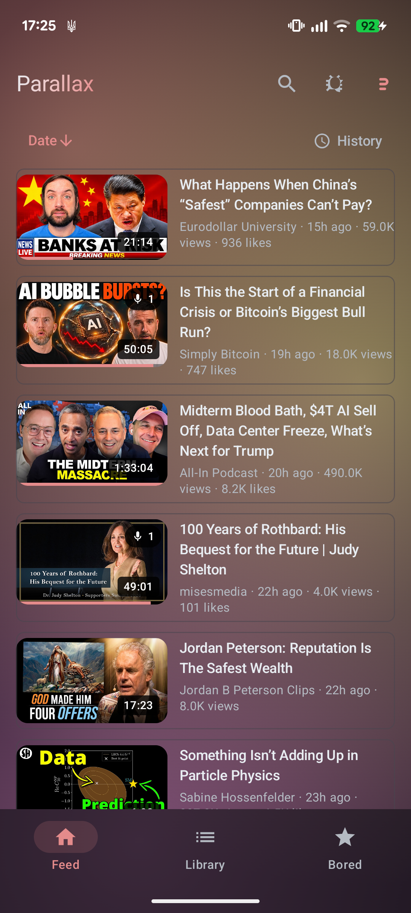
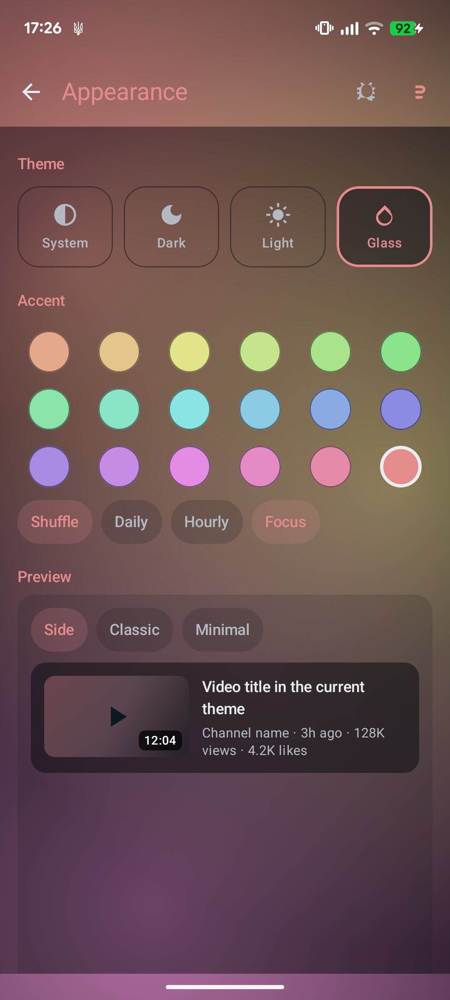
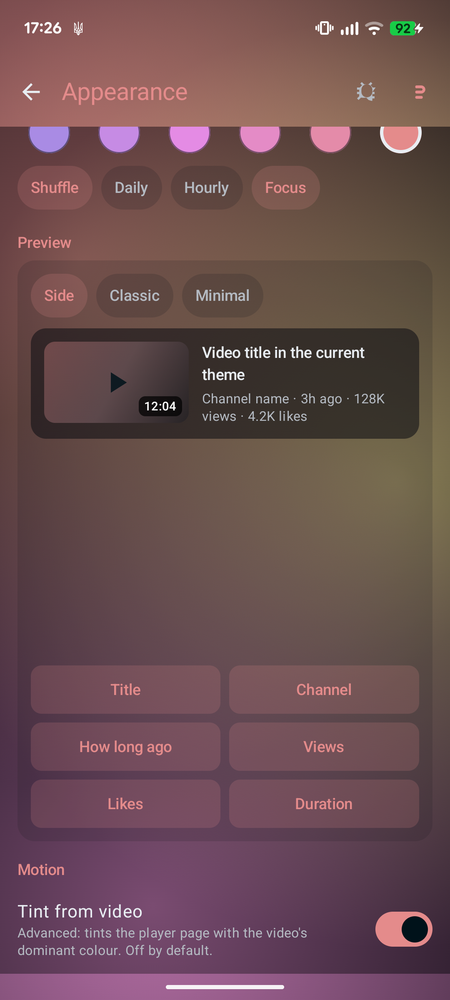
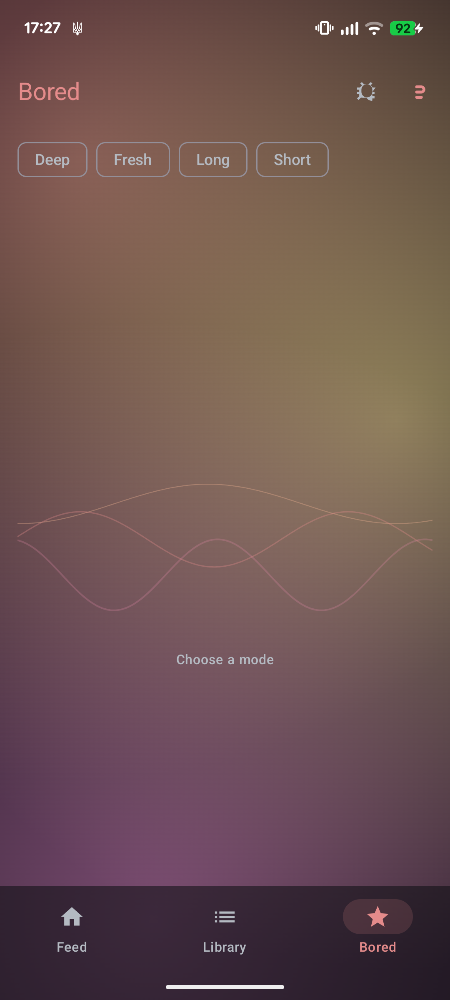
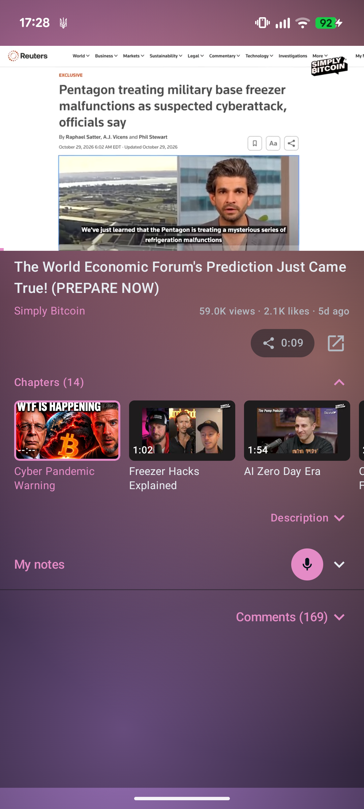
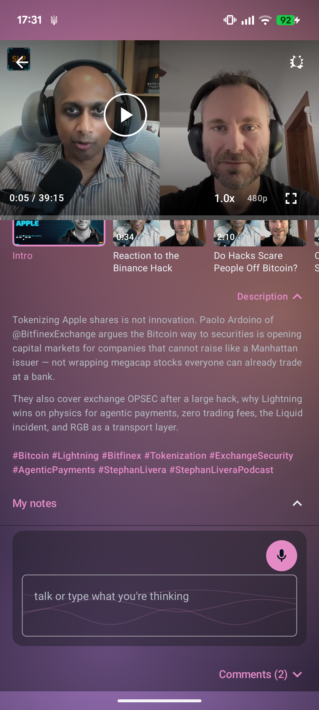

# Parallax

A native Android client for YouTube. Subscriptions, history, notes and preferences live in a local SQLite database, and there is no Parallax server anywhere.

Package `com.presaince.parallax`, minSdk 33, targetSdk 36. Licence GPLv3.

## Screenshots

<table>
<tr>
<td><br><b>Feed.</b> Side cards, one column, sort and History on the header.</td>
<td><br><b>Appearance · Glass.</b> Glass inherits Dark or Light, accent picker with Shuffle.</td>
</tr>
<tr>
<td><br><b>Preview.</b> The card you change is on the same screen as the controls.</td>
<td><br><b>Bored.</b> Four modes (Deep, Fresh, Long, Short) with a visible path.</td>
</tr>
<tr>
<td><br><b>Chapters.</b> Horizontal thumbnail row, tap to seek, active chapter highlighted.</td>
<td><br><b>My notes.</b> Dictation mic plus text field, stamped at the playhead.</td>
</tr>
</table>

Captured on a Pixel 7 from the debug build.

## What you get

- **Feed and Library.** Channel feed, Grid / By channel / Collections in the Library, grouped History with watch counts.
- **Player.** Controls on the picture, 56dp play/pause with a ring, vertical swipes for volume and brightness, horizontal slide to seek, downward drag to minimise. Mini-player strip stays under the bar while audio keeps playing.
- **Chapters.** Parsed from the description, or generated by AI chapters (Room v11) when there are none. Horizontal row or list, set in Settings → Playback.
- **Notes.** Timestamped notes with dictation. Text field is always there, starts at the playhead, per-note copy and edit.
- **Clip sharing.** One sheet for "This moment" or "A clip", two draggable ends, link carries the start, range travels as text.
- **Bored Mode.** Recipe-driven recommendations (Deep Cut, Fresh, Longform, Short Break) with the walk visible.

## What we improved

Pulled from `LEDGER.md` (bugs fixed and upgrades shipped):

- Glass no longer needs its own tone chips. It inherits the last ordinary theme you picked, so Dark → Glass gives dark glass and Light → Glass gives light glass.
- The tab pager stays composed under every pushed screen. Going back never refetches and never loses scroll, which is what makes the minimise reveal feel instant.
- Feed sorting is one shared row (Date, Likes, Views, Progress, Duration, A–Z) and History is a named pill on the header, not an icon lost beside a sort row.
- Description collapse is measured by real text, not a fixed 72dp clip, and the preview takes the first four lines from the top.
- Seek is seconds per tenth of the screen (2 / 5 / 10, rising with distance) instead of a share of the whole video, so a small swipe on a long video no longer jumps minutes.
- The mini-player pause button is gone. It never answered reliably. X stops, sideways swipe hides the card while audio keeps playing, swipe up reopens.
- The preference page puts Preview second, in its own full-width card, with layout modes and the six facts under it. You see the card you are changing.
- Settings is eight sections behind a persistent search field with curated keywords and one-typo tolerance. Every section is its own route.
- Bridge of features from the bug screen: note field and Send posts one JSON bundle, reports sit server-side behind a 403, and there is deliberately no shared secret in the APK. A token inside an APK would be extractable by anyone who unpacks it.
- Keyboard for a left-edge speed panel, live-time share pill, PiP toggle, tappable description links, and a media notification that shows the thumbnail. Landscape exit no longer strands the app sideways.
- Search is only on Feed and Library. Bored Mode, Settings and pushed screens stopped showing the magnifier for the same screen.

For the full list see `LEDGER.md` → Bugs / Upgrades.

## Private by design

No analytics, no account, no Parallax server. The only outbound traffic is to YouTube (through the extractor), SponsorBlock, and — only if you switch it on and supply your own key — the model endpoint you choose for Timestamp Resync.

See `docs/PRIVACY.md`.

## Get it

Sideload the signed release APK. `minSdk 33` is required because NewPipeExtractor uses JDK APIs that only exist from API 33.

CI builds on every tag. `.github/workflows/release.yml` attaches `app-release.apk` to a `v*` release. The direct build is uploaded by this project (`deploy-apk.properties`), not carried in any portfolio. The portfolio only links to the URL.

## Build

Requirements: JDK 21, Android SDK with platform 36. No Android Studio needed.

```bash
./gradlew :app:assembleDebug
./gradlew :app:testDebugUnitTest
adb install -r app/build/outputs/apk/debug/app-debug.apk
```

Versions are pinned inline in `app/build.gradle.kts`. There is no version catalogue. One module, one place to look.

### Release build

Signing reads from the environment so no key material lives in the repository:

```bash
PARALLAX_KEYSTORE=/path/to/parallax.jks \
PARALLAX_KEYSTORE_PASSWORD=... \
PARALLAX_KEY_ALIAS=... \
PARALLAX_KEY_PASSWORD=... \
./gradlew :app:assembleRelease
```

Without those variables the release variant still compiles, unsigned. CI reads the same names from Actions secrets.

## Where things live

```text
app/src/main/java/com/presaince/parallax/
  core/        AppResult, time formatting
  data/        model, source (the extractor boundary), db (Room), library (feed),
               resync, discover (recipes), secure (Keystore-backed prefs)
  playback/    PlaybackController and PlaybackService
  feature/     one package per screen
  ui/          theme and the route stack in one file
```

Two rules worth knowing before changing anything:

1. **The UI never touches the extractor.** Everything goes through `VideoSource`. That keeps the app testable on the JVM and a fallback source possible.
2. **Stream URLs are never persisted.** They are signed and expire. Persist the video id, resolve again on play.

Architecture and product rules are in `ARCHITECTURE.md` and `BEHAVIORS.md`. Milestones are in `ROADMAP.md`.

## Tests

JVM tests cover pure logic: timestamp formatting, subscription import parsing, gesture arbitration, comment cache encoding, subtitle parsing, resync prompt building and reply parsing, recipe validation and scoring, feed jitter.

The extractor canary is skipped by default because it needs the network:

```bash
./gradlew :app:testDebugUnitTest --tests '*ExtractorCanaryTest*' -Dparallax.canary=true
```

CI runs it nightly. When YouTube changes its markup, that job fails first.

## Status

Milestones M0–M7 are built (M6 is scaffolded, it needs a Google OAuth client). The M1 daily-use gate has not been run. Treat this as a working shape, not a finished release.

## Licence

GPLv3. Every source file carries the header. See `LICENSE`. NewPipeExtractor is a dependency and is never vendored.
